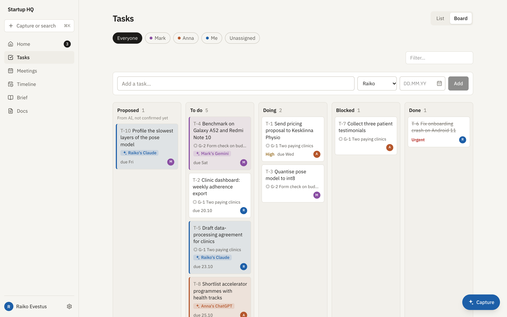
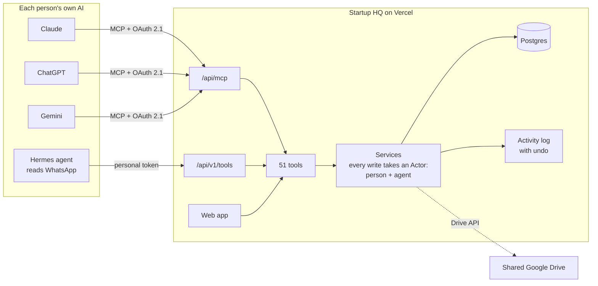
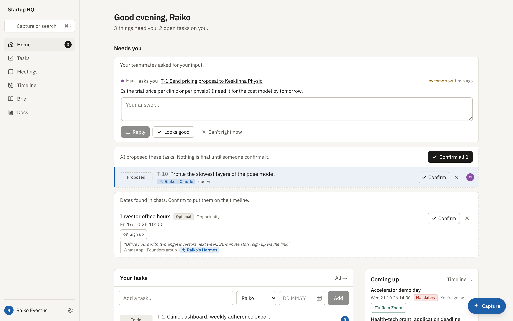
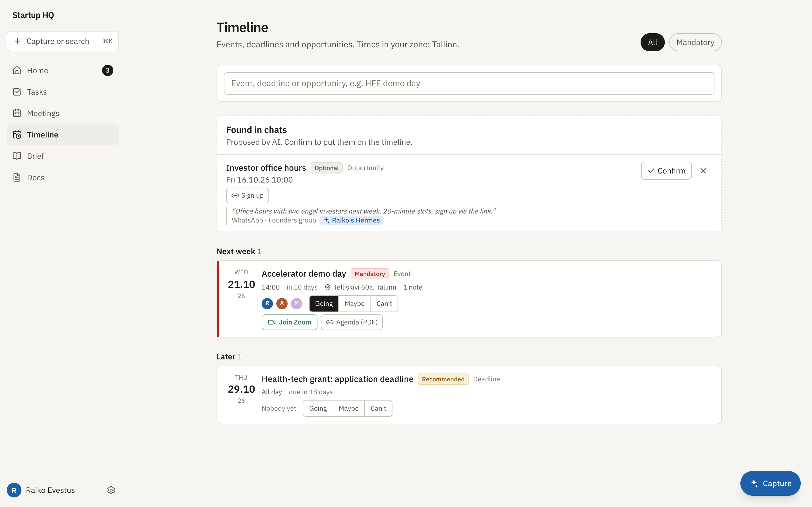
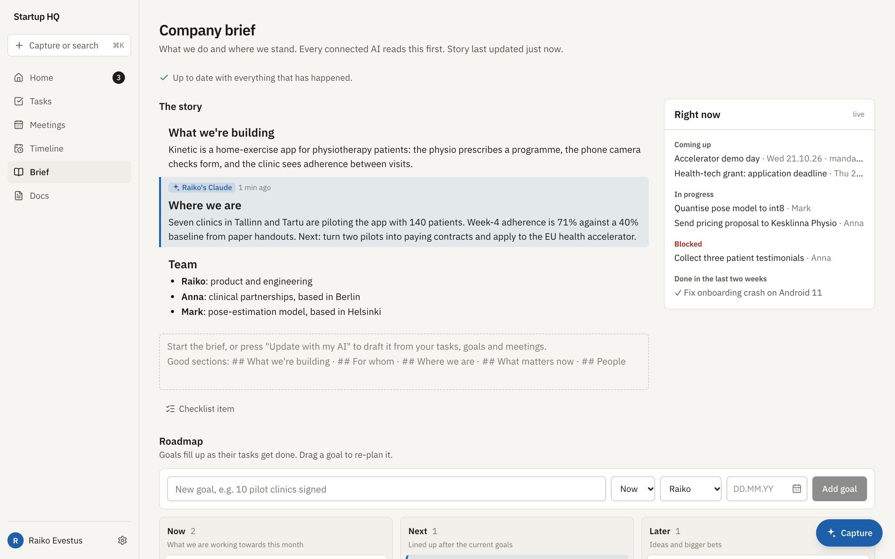
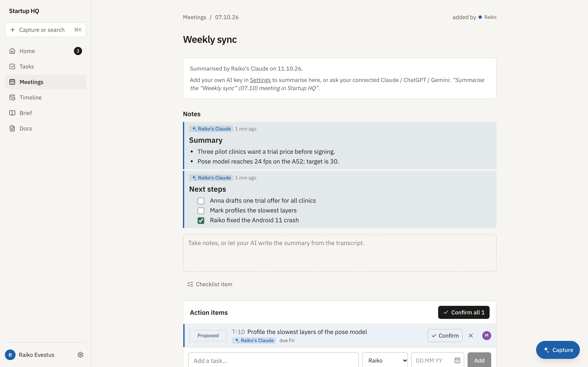

# Startup HQ

**A workspace for a small startup team that their AIs can run.** Tasks, meetings, decisions,
a living company brief and a timeline of events, exposed as an MCP server so each person's
own Claude, ChatGPT, Gemini or agent can do the busywork, on their own subscription,
without ever silently overwriting a human.

<picture>
  <source media="(prefers-color-scheme: dark)" srcset="docs/screenshots/board-dark.png">
  
</picture>

Built for and used daily by a three-person health-tech startup in an accelerator. Meetings
happen in Estonian on Discord, events arrive through WhatsApp groups, and nobody wanted to
spend their week copying things between Google Docs and a task list.

---

## Why

Most "AI-powered" tools put one model behind one company's API key. That breaks down for a
small team:

- **Everyone already pays for an AI.** One person uses Claude, another ChatGPT. Nobody
  wants a third subscription, or to burn the founder's credits.
- **AI output needs an owner.** When an assistant rewrites a task description, the team
  has to know it was the AI, whose AI, and be able to undo it.
- **The busywork is the input.** Transcripts, WhatsApp announcements and forwarded emails
  carry the decisions and dates. Turning them into tasks and events is the work to
  automate.

So Startup HQ is the shared source of truth, and the AIs come to it.

## How it works



- **Bring your own AI.** The app is a remote [MCP](https://modelcontextprotocol.io) server
  with its own OAuth 2.1 authorization server (dynamic client registration, PKCE,
  refresh-token rotation). Add the URL as a connector in Claude or ChatGPT, sign in with
  Google, and your assistant works as you. Agents and scripts use personal tokens over a
  plain REST shim. Every surface uses the same 51 tool definitions.
- **Everything is attributed.** Every row stores *who* and *which agent*: "Anna" or
  "✦ Anna's ChatGPT". AI work is tinted in its person's colour everywhere it appears.
- **AI never overwrites a person.** When an AI edits text a human wrote, the edit becomes a
  suggestion that a person accepts or rejects. Tasks and events an AI infers arrive as
  *proposed*. Every change lands in an activity log and can be reverted.
- **Asking, not sending.** An AI can draft an answer to a teammate's question, but only the
  person can send it.

## What's inside

<table>
<tr>
<td width="50%"><br><b>Home.</b> One inbox: questions from teammates, tasks and events your AIs proposed, and what's coming up.</td>
<td width="50%"><br><b>Timeline.</b> Events, deadlines and opportunities. An agent proposes them from WhatsApp groups and keeps the source quote.</td>
</tr>
<tr>
<td><br><b>Company brief.</b> A story people and AIs keep current, next to a live "right now" computed from goals, tasks and decisions. Every AI reads it first.</td>
<td><br><b>Meetings.</b> Paste a transcript in any language; your AI writes the summary, decisions, proposed action items and follow-ups for the next agenda.</td>
</tr>
</table>

- **Tasks** as a list or a drag-and-drop board, grouped by goal, with checklists and
  comments. `@Anna can you check this before Friday?` asks Anna and sets the due date.
- **Decision log** with decisions made and decisions still to make.
- **Goals and roadmap** (now / next / later) that fill up as their tasks get done.
- **Capture** (⌘K / Ctrl+K): one box that turns a line into a task, a pasted transcript into
  a meeting, or a forwarded email into an event with the right date, time zone and join link.
- **Time zones done properly.** The team lives in several countries. Every event keeps the
  zone it happens in; everyone sees it in their own.
- **Languages.** Menus are English; AIs answer in whatever language you write to them in.
- **Background work, opt-in.** On your own API key (Anthropic, OpenAI, Google or DeepSeek):
  summarise new transcripts, keep the brief current, write the Monday summary.
- **Google Drive**: the shared folder, searchable and readable by the AIs.

## Design decisions worth a look

| Decision | Why |
|---|---|
| The app is an MCP server, not an AI client | Consumer AI subscriptions can't be used from third-party apps. Making the app the *tool* lets each person's own assistant do the work, on their plan. |
| Authorship on every row (person + agent) | "Raiko's Claude changed this" is the minimum a team needs to trust AI edits. It also drives the colouring, suggestions and undo. |
| AI edits to human text become suggestions | Text a person wrote stays theirs until they accept a change. AI-written text can be edited by anyone. |
| One tool registry for MCP, REST and the in-app assistant | 51 tools defined once with Zod schemas, so every surface behaves the same. |
| Proposed → confirmed for inferred items | An agent reading WhatsApp is right most of the time. A wrong item costs one click instead of polluting the board. |
| Plain Postgres and server actions, no client state library | Three users. The simplest thing that works is a database, server components and revalidation. |

## Stack

Next.js 16 (App Router, server actions) · React 19 · TypeScript · Tailwind CSS 4 ·
Prisma 6 on Neon Postgres · AI SDK 7 (Anthropic, OpenAI, Google, DeepSeek) · Vercel and
Vercel Cron · Google OAuth and Drive over plain `fetch` · dnd-kit.

| Path | What |
|---|---|
| `src/lib/services/*` | Domain logic. Every write takes an `Actor` (person + agent). |
| `src/lib/tools.ts` | The AI's capabilities, defined once; used by MCP, REST and the assistant. |
| `src/lib/mcp.ts`, `src/app/api/mcp` | Stateless MCP (streamable HTTP, JSON responses). |
| `src/app/api/oauth/*`, `src/app/oauth/authorize`, `src/app/.well-known/*` | OAuth 2.1 server with PKCE and dynamic client registration. |
| `src/app/api/v1/tools/[name]` | The same tools over plain HTTP with a bearer token. |
| `agent/hermes/startup-hq` | Skill for the Hermes agent: WhatsApp announcements → timeline. |
| `scripts/seed-demo.ts` | A made-up startup for trying it out (the screenshots above). |

## Run it locally

You need Node 20+ and a Postgres database.

```bash
npm install
cp .env.example .env    # then fill in DATABASE_URL and APP_SECRET
npx prisma migrate deploy
npm run seed:demo       # optional: a made-up three-person startup
npm run dev
```

Open <http://localhost:3000/api/auth/dev?email=raiko@example.com> to sign in as the demo
owner without Google (development only).

### Connect an AI

**Settings → Connect your AI** shows your MCP URL (`https://<your host>/api/mcp`) with
step-by-step instructions for Claude and ChatGPT. For agents and scripts, create a
personal token in Settings and call `POST /api/v1/tools/<tool>` with
`Authorization: Bearer <token>`.

## Deploy

Vercel with the Neon integration; `vercel-build` runs the migrations.

| Variable | |
|---|---|
| `DATABASE_URL`, `DATABASE_URL_UNPOOLED` | Postgres (set by the Neon integration) |
| `APP_SECRET` | 32+ random characters; encrypts stored API keys and the Drive token |
| `APP_URL` | Public origin, e.g. `https://your-app.vercel.app` |
| `OWNER_EMAIL` | The owner's Google email; signs in first and adds the others |
| `GOOGLE_CLIENT_ID`, `GOOGLE_CLIENT_SECRET` | Google OAuth web client |
| `CRON_SECRET` | Protects `/api/cron/weekly` |

<details>
<summary>Setting up the Google OAuth client</summary>

Google Cloud console → APIs & Services:

1. Enable the **Google Drive API**.
2. OAuth consent screen: External, add the scope `.../auth/drive`, then **Publish app**.
   In Testing mode Google expires the Drive refresh token after 7 days. Unverified is
   fine for under 100 users; people see an "unverified app" warning once.
3. Credentials → OAuth client ID → Web application. Authorized redirect URI:
   `https://<APP_URL host>/api/auth/google/callback` (and
   `http://localhost:3000/api/auth/google/callback` for local development).

</details>

Only people the owner adds in Settings can sign in; there is no public sign-up.

## About

Designed and built by [Raiko Evestus](https://github.com/fiifee) with
[Claude Code](https://claude.com/claude-code) as a pair programmer: I made the product and
architecture decisions, reviewed the code, and run it with my team.

[MIT licensed](LICENSE).
